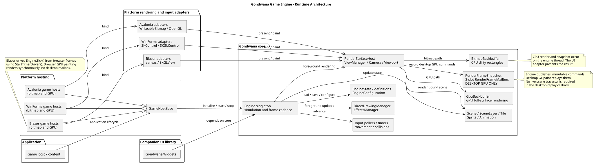
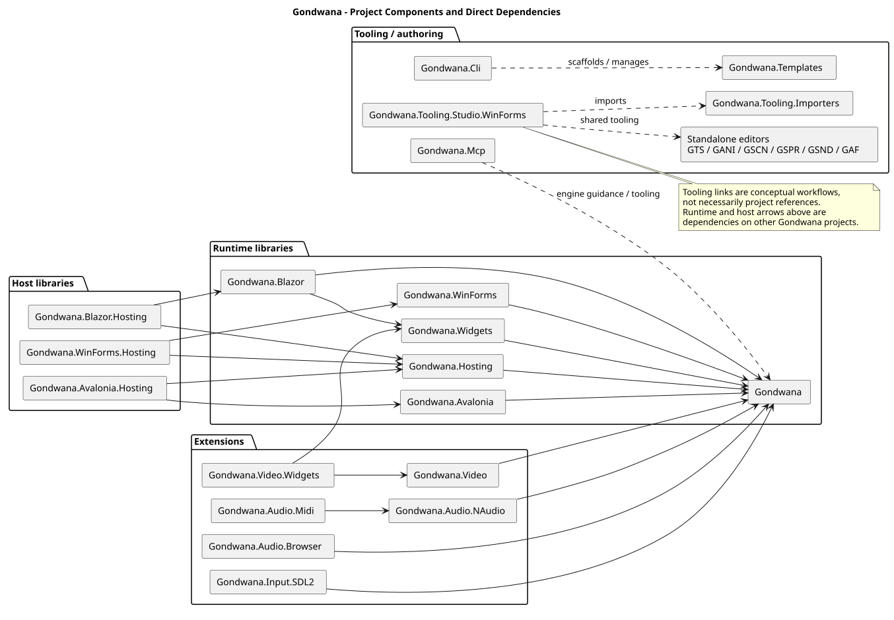
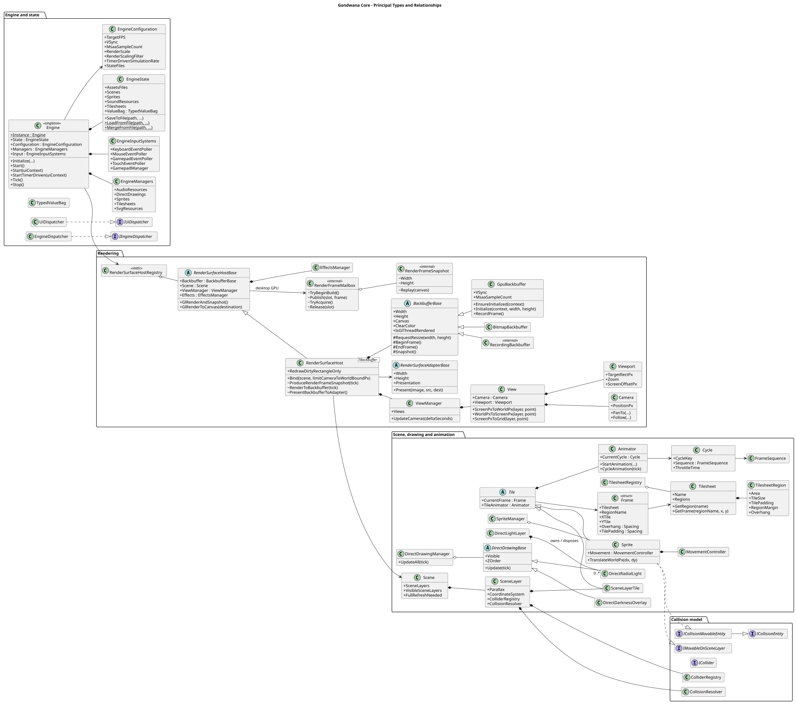
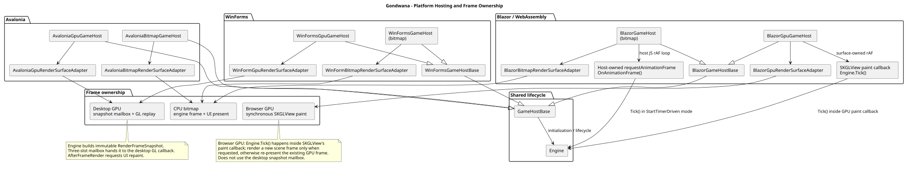
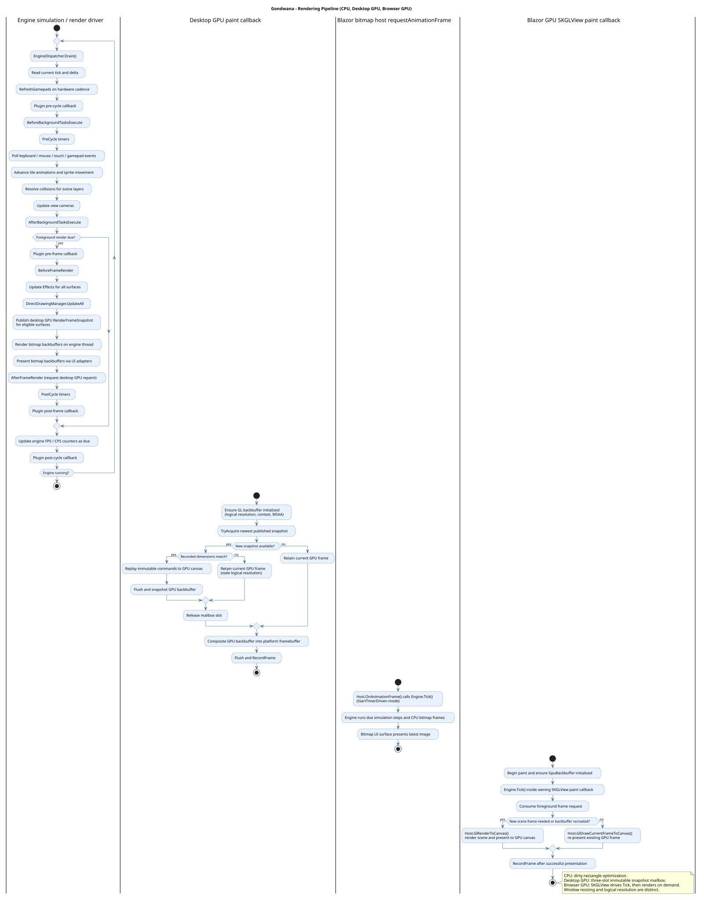
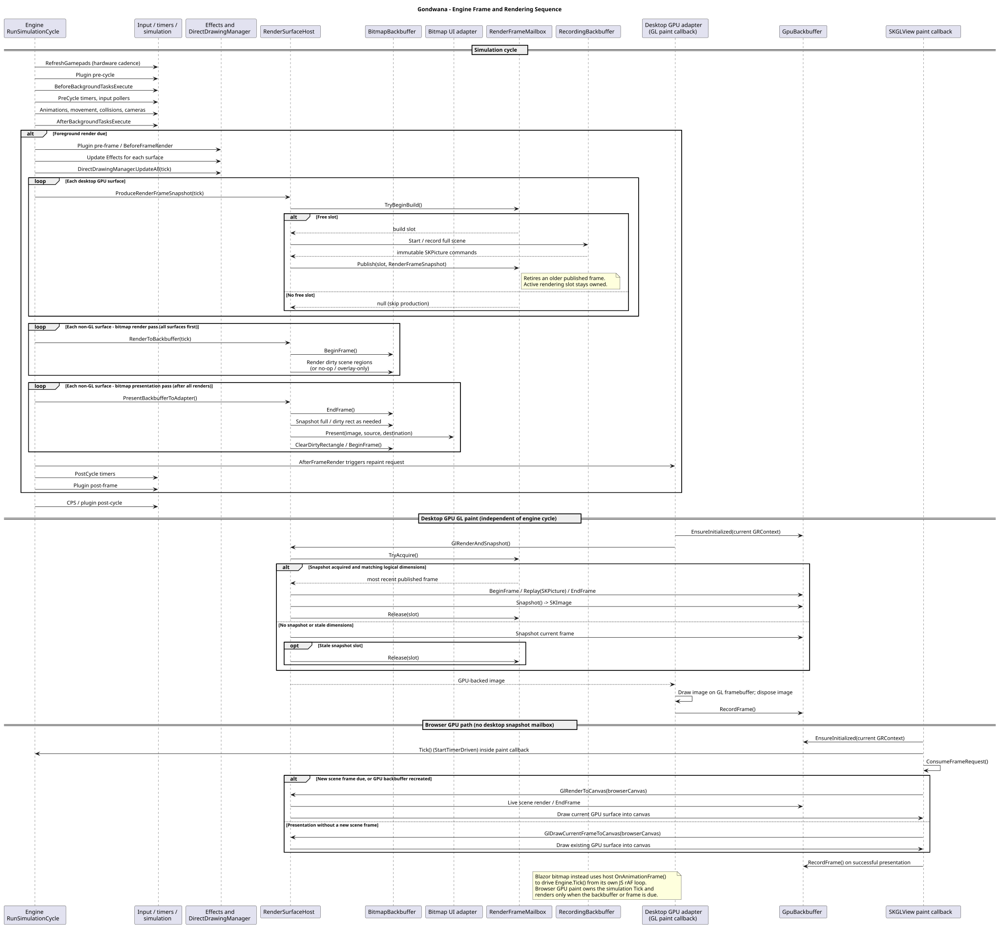
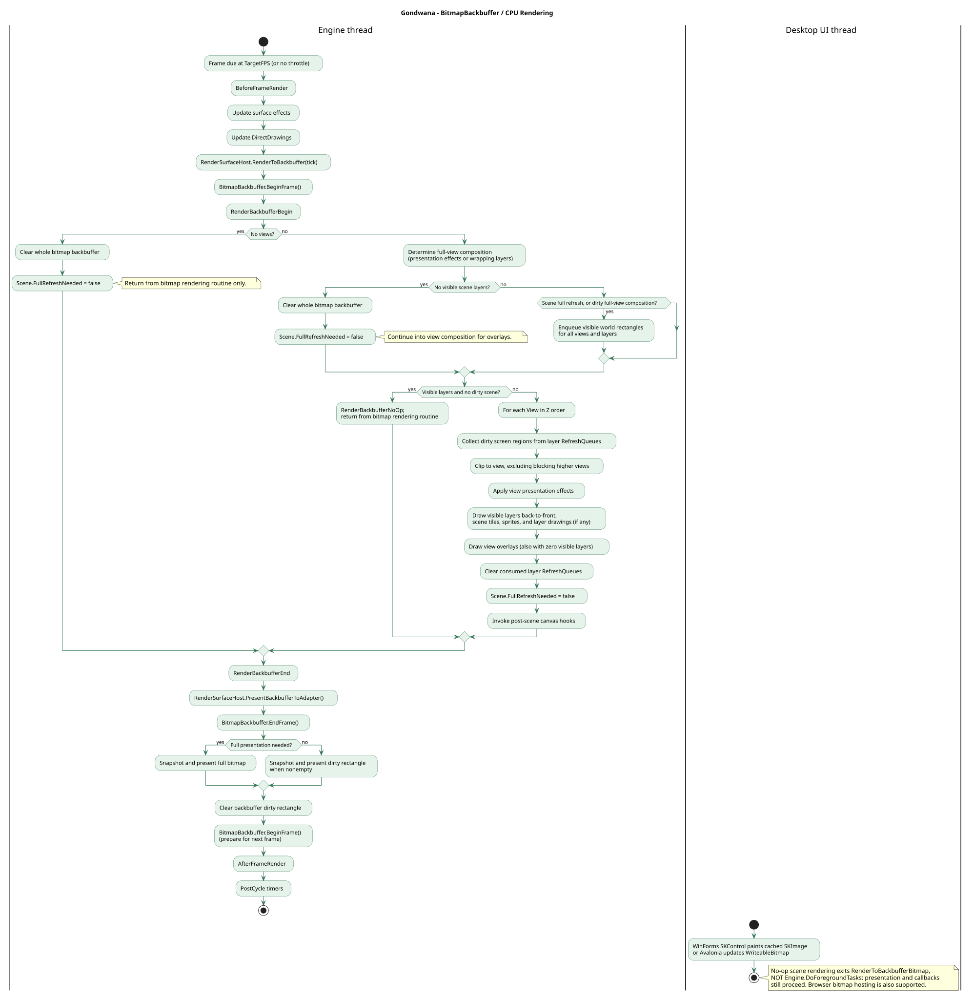
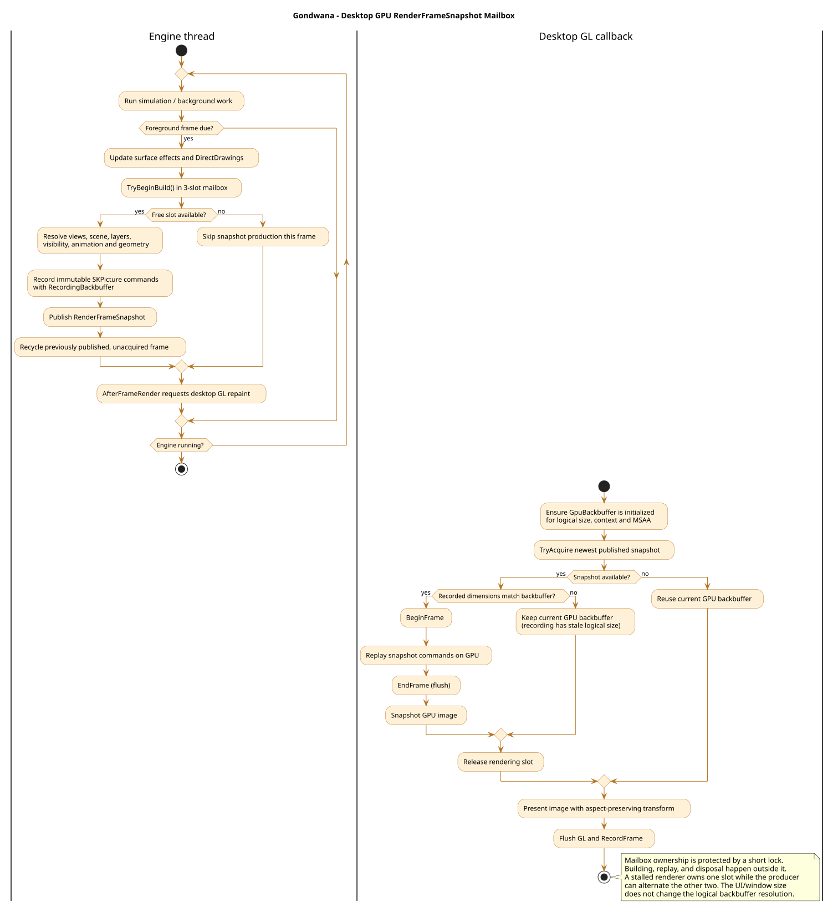

# Architecture Diagrams

These diagrams are generated from the [authoritative PlantUML sources](https://github.com/Isthimius/Gondwana/tree/master/Solution%20Items/documentation). The checked-in SVG images display directly in the Wiki without an external rendering service.

For a guided explanation, see [[Engine Architecture Overview]], [[Game Hosts and Application Startup]], and [[Rendering Pipeline]].

## Engine architecture

Runtime layering, platform adapters, and rendering responsibilities.

[View or edit the PlantUML source](https://github.com/Isthimius/Gondwana/blob/master/Solution%20Items/documentation/architecture-diagram.puml)

## Project components

Runtime libraries, hosting projects, extensions, and tools.

[View or edit the PlantUML source](https://github.com/Isthimius/Gondwana/blob/master/Solution%20Items/documentation/component-diagram.puml)

## Core class relationships

Selected engine, scene, rendering, input, and drawing APIs.

[View or edit the PlantUML source](https://github.com/Isthimius/Gondwana/blob/master/Solution%20Items/documentation/core-class-diagram.puml)

## Platform hosting

Platform hosts, rendering adapters, and frame drivers.

[View or edit the PlantUML source](https://github.com/Isthimius/Gondwana/blob/master/Solution%20Items/documentation/platform-hosting-diagram.puml)

## Rendering pipeline overview

Desktop bitmap, desktop GPU, and Blazor paths.

[View or edit the PlantUML source](https://github.com/Isthimius/Gondwana/blob/master/Solution%20Items/documentation/rendering-pipeline-flowchart.puml)

## Rendering sequence

Engine phases, surface rendering/presentation, and browser paint.

[View or edit the PlantUML source](https://github.com/Isthimius/Gondwana/blob/master/Solution%20Items/documentation/rendering-pipeline-sequence.puml)

## Bitmap backbuffer

Dirty-area rendering, overlay composition, and presentation.

[View or edit the PlantUML source](https://github.com/Isthimius/Gondwana/blob/master/Solution%20Items/documentation/rendering-pipeline-flowchart-bitmap-backbuffer.puml)

## Desktop GPU backbuffer

Immutable snapshot production, mailbox, and GL replay.

[View or edit the PlantUML source](https://github.com/Isthimius/Gondwana/blob/master/Solution%20Items/documentation/rendering-pipeline-flowchart-gpu-backbuffer.puml)

## Maintenance

Edit `.puml` files under `Solution Items/documentation`, not the generated SVGs. The diagram workflow runs **only when a `.puml` file changes**, generates and checks the SVG images, and commits updates to the same feature branch. After merge, normal wiki-sync publishes these assets.
